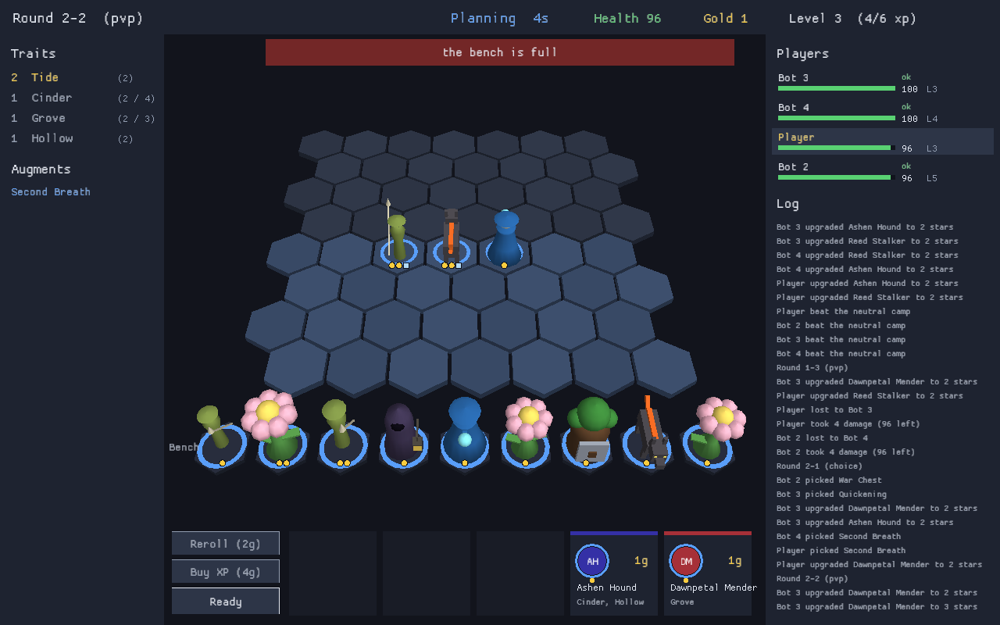
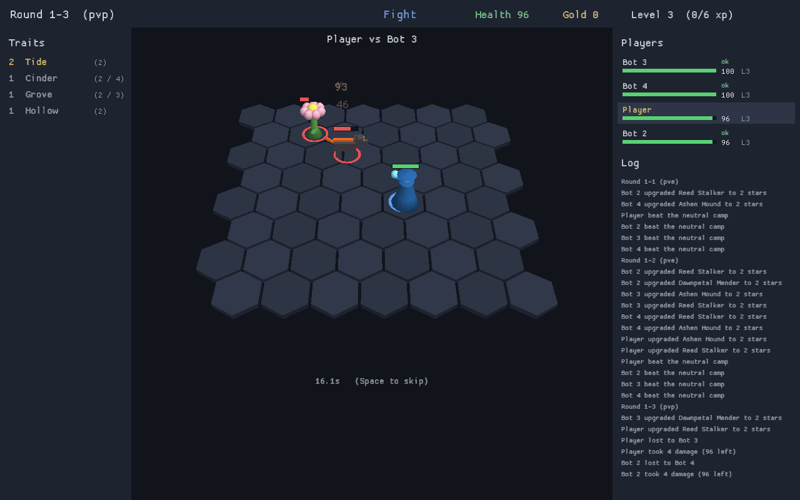

# AutoEngine

A Rust engine for building autochess games. The core is a headless,
deterministic simulation library. A headless server runs the game, and
clients contain only graphics and input: they send the player's commands and
draw what the server reports.




## Quick start

```
cargo run -- new mygame                 # write a small starter game
cargo run -- check mygame               # look for mistakes
cargo run -- test mygame                # run its fights and check the results
cargo run -- lobby --content mygame     # bots play a whole game

cargo run --bin autoengine-server -- --dev       # terminal 1: host the sample game
cargo run -p autoengine-client -- --name You     # terminal 2: play it
```

## Learn

| If you want to | Read |
| --- | --- |
| make a game out of data files | [docs/guide.md](docs/guide.md), a walk through every tool |
| write scripts or build on the library in Rust | [docs/programming.md](docs/programming.md) and `examples/` |
| make it look and sound like your game | [docs/art.md](docs/art.md) |
| play, host, or change the client | [docs/client.md](docs/client.md) |
| host games, write a client, or tune the server | [docs/networking.md](docs/networking.md) |
| look up a type or function | `cargo doc --open` |

## Tools

`cargo run -- help` lists these. Outside a checkout the command is `autoengine`.

| Command | What it does |
| --- | --- |
| `new DIR` | writes a small, commented starter game |
| `check [DIR] [--watch]` | finds mistakes in content; `--watch` re-checks and re-tests on every save |
| `test [DIR]` | runs the fights in `tests.ron` and checks what was expected of them |
| `fight [SEED]` | runs one fight and prints everything that happens |
| `lobby [SEED]` | bots play a whole game |
| `sim [--games N] [--json]` | bots play many games and report win rates per unit and trait |
| `bench` | measures fights and games per second |
| `replay FILE...` | fights saved replays again and reports any that changed |
| `api` | prints everything scripts can call |

In the client: a cheat console (F1, on servers started with `--dev`), a
statistics overlay (F3), an asset viewer (`--view FILE`) and live reload of
the theme, models and icons.

## What is in the box

- **Fights**: tick-based combat on a hex board with targeting, movement, mana and abilities, shields, statuses, triggered passives and summons. Abilities, trait bonuses and item effects are data built from the same blocks.
- **The game around them**: shared unit pool, shop odds by level, gold with interest and streaks, bench and board, star upgrades, item recipes, augments, elimination and placements.
- **Rounds**: player fights, neutral fights, a shared draft, choice rounds, and your own kinds from scripts or Rust, in whatever order `rounds.ron` says.
- **Hosting**: a headless server with bots for empty seats, reconnecting, spectators and per-player hiding of private information. The server decides every result and clients only send intents. Only changes are sent, fights travel as a seed the client replays, and slow, silent or flooding connections are dropped without affecting anyone else.
- **A 3D client**: models through Assimp, skeletal animation, particles, sound, settings, and everything visual driven by data files.
- **Determinism**: integer math and seeded dice, so the same seed always gives the same fight and the same game. Replays, content tests and the simulator rest on this.

The library is layered so you can use part of it, and the sample set in
`content/` is original. Run `cargo test --workspace` for the test suite.
