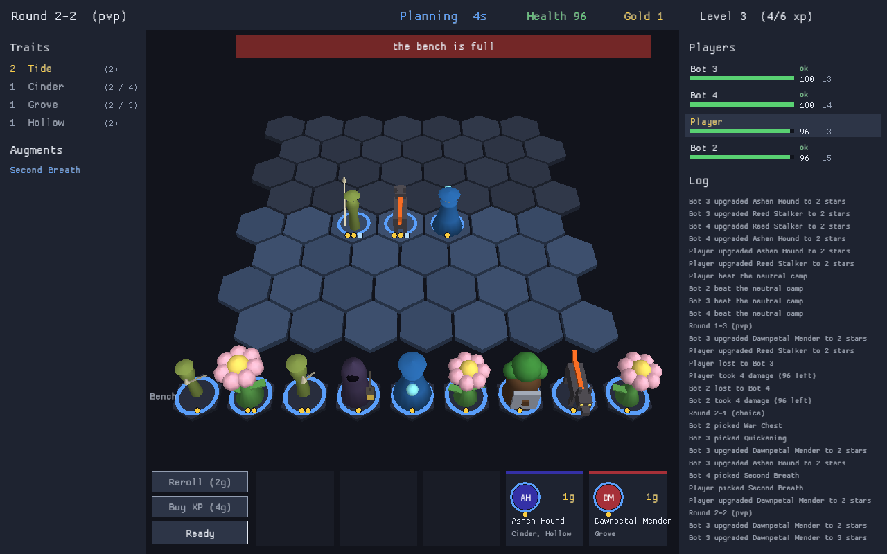
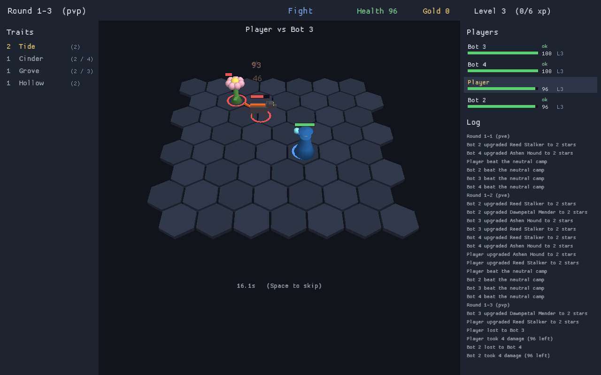

# AutoEngine

A Rust engine for building autochess games. The core is a headless,
deterministic simulation library. A headless server runs the game, and
clients contain only graphics and input: they send the player's commands and
draw what the server reports.




## Quick start

Games are pure Rust: content is defined with `ContentSet::builder()` (see
`src/sample.rs`), and every tool below runs on it.

```
cargo play                              # open the client on a local sample game with bots
cargo game help                         # the developer commands (same as `cargo run -- help`)

cargo run -- check                      # look for mistakes in the sample game
cargo run -- test                       # run its content tests
cargo run -- lobby                      # bots play a whole game
cargo run -- new ../mygame              # write a starter game crate of your own

cargo run -- serve --dev                         # terminal 1: host the sample game
cargo run -p autoengine-client -- --name You     # terminal 2: play it
```

## Learn

| If you want to | Read |
| --- | --- |
| make a game | [docs/guide.md](docs/guide.md), a walk through every tool |
| make units, traits, items, augments, rounds and rules | [docs/guides/](docs/guides/README.md): every call, effect and event, with examples |
| write scripts or build on the library in Rust | [docs/programming.md](docs/programming.md) and `examples/` |
| make it look and sound like your game | [docs/art.md](docs/art.md) |
| play, host, or change the client | [docs/client.md](docs/client.md) |
| host games, write a client, or tune the server | [docs/networking.md](docs/networking.md) |
| look up a type or function | `cargo doc --open` |

## Tools

`cargo run -- help` lists these. They come from `autoengine::tools::cli`, so a
game's own crate gets all of them for its content by passing a `GameSpec` to
`cli::run` from its `main` (the starter game does this).

| Command | What it does |
| --- | --- |
| `new DIR` | writes a small, commented starter game crate |
| `check` | finds mistakes in the content |
| `test [--filter TEXT]` | runs the content tests and checks what was expected of them |
| `fight [SEED]` | runs one fight and prints everything that happens |
| `lobby [SEED] [--bots easy\|normal\|hard\|mixed] [--save FILE]` | bots play a whole game |
| `sim [--games N] [--bots LEVEL] [--json]` | bots play many games and report win rates per unit and trait |
| `bench` | measures fights and games per second |
| `serve [--rooms N] [--bots LEVEL] [--dev] [--record DIR [--resume]] ...` | hosts the game, or many games at once, for clients over TCP (`autoengine-server` is the same) |
| `replay FILE...` | fights saved replays again and reports any that changed |
| `match FILE [--rounds]` | plays a saved match again, checks it ends the same, and summarizes it |
| `api` | prints everything scripts can call |

In the client: chat (Enter), a cheat console (F1, on servers started with
`--dev`), a statistics overlay (F3), an asset viewer (`--view FILE`), live
reload of models and icons, a list of games on servers hosting many, and an
end-of-game table of everyone's stats.

## What is in the box

- **Fights**: tick-based combat on a hex board with movement, abilities paid for with mana or with resources the game defines (rage, energy and so on, each with its own rules, costs and cooldowns), stats and damage types of the game's own, signals and named marks for content to react to, targeting priorities (nearest, farthest, weakest and so on), shields, crowd control (stun, silence, disarm, root, taunt) with tenacity and unstoppable, wounds, invulnerability, cleansing, dodge, executes, pulls, knockback and leaps, triggered passives (including on crit and shield break), summons, conditions, named stacks, and overtime that ends stalemates. Abilities, trait bonuses and item effects are data built from the same blocks, and Rust hooks cover anything the blocks can't express.
- **Content in code**: units, traits, items, augments, rounds and content tests are Rust, built with `ContentSet::builder()` and validated when built, with spelling suggestions for mistyped ids. Names and descriptions can be translated into other languages.
- **The game around them**: a shared unit pool (shops hold the copies they show, and clients see how many are left), shop odds by level, gold with interest and streaks, bench and board with auto-fill, star upgrades, item recipes and single-use items, augments that pay out every round, lobby-wide modifiers, choice rerolls, opponent rotation that avoids rematches, forfeiting, elimination and placements, and per-player stats for the end-of-game screen.
- **Rounds**: player fights, neutral fights, a shared draft, choice rounds, and your own kinds from scripts or Rust, in whatever order the schedule says, each kind with its own planning time if wanted.
- **Hosting**: a headless server, alone or as a hub of many games, with bots at three difficulties for empty seats, reconnecting, spectators (optionally delayed), moderated chat, a ladder, per-player hiding of private information, and matches saved after every round so a stopped server, or every game on a hub, can resume. Operators can pause games, kick players and post announcements from the terminal or from Rust. The server decides every result and clients only send intents. Only changes are sent, fights travel as a seed the client replays, and slow, silent, flooding or greedy connections are dropped without affecting anyone else.
- **A 3D client**: models through Assimp, skeletal animation with cross-fades, particles, sound, a damage meter after every fight, tooltips, rebindable hotkeys, chat, a game list, colour-blind colours and settings. It gets each game's content from the server, so one client plays any game.
- **Determinism**: integer math and seeded dice, so the same seed always gives the same fight and the same game. Fight replays, whole-match logs, content tests and the simulator (which uses every core) rest on this.

The library is layered so you can use part of it, and the sample set in
`content/` is original. Run `cargo test --workspace` for the test suite.
